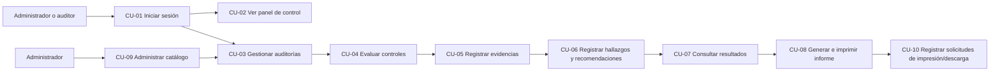
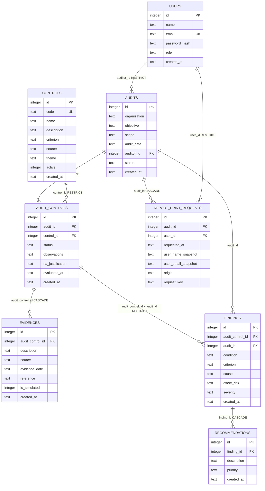
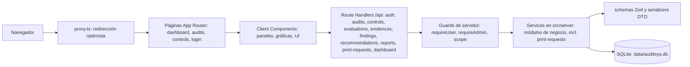

# AuditSys Mini — Documentación técnica

Aplicación web académica para gestionar auditorías de seguridad de la información basadas en los controles del Anexo A de ISO/IEC 27001:2022. **No certifica organizaciones** y el indicador **no sustituye el juicio profesional** del auditor.

---

## 1. Requisitos

### 1.1 Requisitos funcionales (RF)

| Código | Requisito | Dónde se implementa |
| --- | --- | --- |
| RF01 | **Registrar auditoría** | `src/server/audits/service.ts` (`createAudit`) y `schemas.ts`; `POST /api/audits`; `AuditForm.tsx` y `src/app/(app)/audits/page.tsx`. La creación genera 15 filas `pendiente`, una por control activo. |
| RF02 | **Gestionar controles** (consultar 15, admin crea/edita/desactiva) | `src/server/controls/{service,schemas}.ts`; `GET/POST /api/controls`, `PUT /api/controls/[id]`; `src/app/(app)/controls/page.tsx` y `ControlForm.tsx`. El seed carga los 15 controles; solo `admin` escribe. |
| RF03 | **Evaluar controles** (4 estados + observaciones; N/A exige justificación) | `src/server/evaluations/{service,schemas}.ts`; `GET /api/audits/[id]/evaluations`, `PUT .../evaluations/[controlId]`; `EvaluationPanel.tsx`. Los 4 estados de evaluación son implementado, parcial, no implementado y no aplicable; `pendiente` es el estado inicial de la fila. |
| RF04 | **Registrar evidencias** (descripción, fuente, fecha, referencia) | `src/server/evidences/{service,schemas}.ts`; `GET/POST /api/audits/[id]/evaluations/[controlId]/evidences`, `DELETE /api/evidences/[id]`; `EvidencePanel.tsx`. Por referencia, sin subida de archivos; `is_simulated` por defecto `true`. |
| RF05 | **Documentar hallazgos** (condición, criterio, causa, efecto/riesgo, severidad) | `src/server/findings/{service,schemas}.ts`; `GET/POST /api/audits/[id]/findings`, `PUT/DELETE /api/findings/[id]`; `FindingPanel.tsx`. Solo sobre controles parciales o no implementados. |
| RF06 | **Asociar recomendaciones** (una o más por hallazgo) | `createRecommendation` en `src/server/findings/service.ts`; `POST /api/findings/[id]/recommendations`, `PUT/DELETE /api/recommendations/[id]`; `FindingPanel.tsx`. El seed registra 9 recomendaciones para 7 hallazgos. |
| RF07 | **Calcular resultados** (cantidades/porcentajes con fórmula visible; N/A fuera del denominador) | `src/server/lib/compliance.ts` (`calculateIndicators`), `src/server/reports/service.ts` (`getResults`), `GET /api/audits/[id]/results`; `ResultsPanel.tsx`. La fórmula se muestra en pantalla y en el informe. |
| RF08 | **Generar informe** (datos, alcance, resultados, hallazgos, recomendaciones, imprimible) | `getReport` en `src/server/reports/service.ts`; `GET /api/audits/[id]/report`; `ReportView.tsx`, `src/app/(app)/audits/[id]/report/page.tsx` y `src/app/globals.css` (`@media print`). |
| RF09 | **Dashboard** (cuadro de indicadores de gestión de auditorías) | `src/server/dashboard/{service,schemas}.ts`; `GET /api/dashboard`; `src/app/(app)/dashboard/page.tsx` y `DashboardCharts.tsx`. |
| RF10 | **Registro de solicitudes de impresión/descarga** (adicional, solicitado tras una observación docente) | `src/server/print-requests/{service,schemas}.ts`; tabla `report_print_requests` en `src/server/db/schema.ts`; `GET/POST /api/audits/[id]/report/print-requests`; `PrintReportButton.tsx` y `PrintRequestHistory.tsx`. |

La **autenticación y el control de acceso no son un RF numerado**: son funcionalidad transversal descrita en el RNF de seguridad (§1.2), en `src/server/auth/**` y en `src/app/api/auth/**`. RF10 es **adicional** a los nueve requisitos originales; no los renumeró.

### 1.2 Requisitos no funcionales (RNF)

- **Usabilidad / responsive:** Tailwind 4; rejillas `sm`/`md`/`lg`, tablas en escritorio y tarjetas en móvil, `aria-label`, `role="tablist"`, mensajes de carga/error/estado vacío.
- **Persistencia:** SQLite con `better-sqlite3` en `data/auditsys.db`; `PRAGMA foreign_keys = ON`; un único archivo, sin migraciones.
- **Validación:** Zod 4 en `body`, `params` y `query` (`src/server/lib/http.ts`) + `CHECK` de SQLite; errores 400 con `details` en español (`src/server/lib/errors.ts`).
- **Seguridad (funcionalidad transversal):** bcrypt para contraseñas; JWT HS256 con `jose` en cookie `httpOnly`, `sameSite=lax` y `secure` en producción; `requireUser()` revalida nombre, correo y rol contra la BD en cada petición y devuelve 401 si el usuario ya no existe; el login ejecuta un `compare` con hash señuelo cuando el correo no existe (coste constante); `toErrorResponse` siempre responde `"Error interno del servidor."` en un 500, sin detalle interno; `allowedDevOrigins: ["127.0.0.1"]` permite desarrollo por IP. Además: roles, scope por auditor, consultas preparadas y secretos en `.env.local`. En RF10 la identidad y los snapshots salen del actor revalidado, nunca del body; `userEmail` solo se expone a `admin`; no se guardan IP ni user-agent.
- **Trazabilidad:** `audit_controls` enlaza control, evaluación, evidencias y hallazgos; `getResults()` expone `trazabilidad` y el informe incluye un anexo con referencias `EVD-ABC-…`. RF10 añade `report_print_requests`, con snapshots inmutables de nombre/correo, `requested_at`, origen y `request_key` idempotente; `UNIQUE(audit_id, user_id, request_key)` evita duplicados por reintento y el cuerpo usa Zod estricto (UUID y origen `resultados`/`informe`; sin filtros de query).
- **Precisión semántica:** el registro de RF10 documenta una **intención de impresión/descarga**, no una descarga confirmada: el diálogo del navegador puede cancelarse. El contador es informativo y no probatorio; cualquier usuario con acceso puede generar solicitudes artificiales. Es un riesgo conocido y aceptado: no se añadió techo temporal (falsearía el recuento) ni se describe el contador como evidencia.
- **Mantenibilidad:** separación `schemas` / `service` / `route`, DTOs compartidos en `src/shared/types.ts`, contexto inyectado en los servicios y 48 pruebas automatizadas en 4 archivos.

### 1.3 Historias de usuario

| # | Historia | Criterio de aceptación |
| --- | --- | --- |
| HU1 | Como **administrador** quiero iniciar sesión para acceder a todas las auditorías | Login 200 con cookie; `/me` devuelve mi rol; sin cookie → 401. |
| HU2 | Como **auditor** quiero ver solo mis auditorías para no tratar datos ajenos | Listado filtrado por `auditor_id`; auditoría ajena → 403. |
| HU3 | Como **auditor** quiero crear una auditoría para empezar a evaluar | Se crea con 15 filas `pendiente`, una por control activo. |
| HU4 | Como **auditor** quiero evaluar controles para registrar el estado real | N/A exige justificación (400 si falta); al guardar se fija `evaluated_at`. |
| HU5 | Como **auditor** quiero adjuntar evidencias simuladas para sustentar hallazgos | Evidencia asociada al `audit_control` y visible en el informe. |
| HU6 | Como **auditor** quiero crear hallazgos y recomendaciones para proponer mejoras | Solo sobre controles parciales o no implementados; si no, 409. |
| HU7 | Como **auditor** quiero consultar resultados para comunicar el avance | Indicador con fórmula, denominador y avisos; pendientes fuera del denominador. |
| HU8 | Como **administrador** quiero imprimir el informe para entregarlo en clase | Botón "Imprimir / Guardar como PDF" y `@media print` sin librerías. |

---

## 2. Casos de uso

- **CU-01:** autenticarse con correo y contraseña; la cookie de sesión habilita el resto de casos.
- **CU-02:** consultar totales, estado de auditorías, cumplimiento promedio y hallazgos.
- **CU-03:** crear, filtrar, editar y cerrar auditorías (cerrar con pendientes está prohibido).
- **CU-04:** cambiar el estado de cada control; N/A requiere justificación.
- **CU-05:** añadir evidencias por referencia, fuente, fecha y marca de simulación.
- **CU-06:** documentar hallazgos con severidad y añadir recomendaciones con prioridad.
- **CU-07:** ver conteos, indicadores, desgloses y trazabilidad control → evidencia → hallazgo → recomendación.
- **CU-08:** abrir el informe imprimible y solicitar la impresión o el guardado como PDF desde el navegador; el archivo real depende del usuario y del diálogo del navegador.
- **CU-09:** dar de alta o editar controles y activarlos/desactivarlos (solo administrador).
- **CU-10:** al pulsar "Imprimir / Guardar como PDF" en resultados o en el informe, registrar la intención antes de abrir el diálogo; consultar el total, el desglose por usuario y las 50 solicitudes recientes. Solo admin ve correos en la API; la UI nunca los muestra.

---

## 3. Modelo entidad-relación

**Diccionario de datos resumido**

| Tabla | Campos clave | Tipo | Descripción |
| --- | --- | --- | --- |
| `users` | `id`, `email`, `role`, `password_hash` | INTEGER / TEXT | Usuarios `admin` u `auditor`; `email` único; hash bcrypt. |
| `audits` | `id`, `organization`, `audit_date`, `auditor_id`, `status` | INTEGER / TEXT | Auditoría; `status` en `borrador`, `en_curso`, `cerrada`; FK a `users` con `RESTRICT`. |
| `controls` | `id`, `code`, `theme`, `active` | INTEGER / TEXT | Catálogo ISO 27002:2022; `code` único; `active=0` excluye de nuevas auditorías. |
| `audit_controls` | `id`, `audit_id`, `control_id`, `status`, `na_justification`, `evaluated_at` | INTEGER / TEXT | Evaluación de un control dentro de una auditoría; `UNIQUE(audit_id, control_id)` y `UNIQUE(id, audit_id)`. |
| `evidences` | `id`, `audit_control_id`, `reference`, `is_simulated` | INTEGER / TEXT | Evidencia por referencia (sin archivo); `is_simulated` es 0/1. |
| `findings` | `id`, `audit_control_id`, `audit_id`, `severity` | INTEGER / TEXT | Hallazgo con condición, criterio, causa y efecto; FK compuesta a `audit_controls(id, audit_id)` con `RESTRICT`. |
| `recommendations` | `id`, `finding_id`, `priority` | INTEGER / TEXT | Acción correctiva de un hallazgo; prioridad `baja`/`media`/`alta`. |
| `report_print_requests` | `id`, `audit_id`, `user_id`, `requested_at`, `user_name_snapshot`, `user_email_snapshot`, `origin`, `request_key` | INTEGER / TEXT | Intención de impresión/descarga; `origin` en `resultados`/`informe`; `UNIQUE(audit_id, user_id, request_key)` e índice `(audit_id, requested_at DESC, id DESC)`. |

Todas las tablas tienen `id INTEGER PRIMARY KEY AUTOINCREMENT`; todas salvo `report_print_requests` tienen `created_at TEXT` con valor por defecto ISO-8601, y esta última usa `requested_at TEXT` con el mismo formato. Las FK usan `ON DELETE CASCADE` cuando el hijo no tiene sentido sin el padre (`audits → audit_controls`, `audits → report_print_requests`, `audit_controls → evidences`, `findings → recommendations`) y `RESTRICT` para no perder integridad referencial (`users → audits`, `controls → audit_controls`, `audit_controls → findings`, `users → report_print_requests`). Hay índices en `auditor_id`, estados, claves foráneas y `(audit_id, requested_at DESC, id DESC)`.

---

## 4. Arquitectura

**Módulos de `src/server`:** `audits`, `controls`, `evaluations`, `evidences`, `findings`, `reports`, `print-requests`, `dashboard`, `auth` y `db` (más `lib/` con constantes, errores, HTTP, compliance y serializadores). Es **una sola app Next.js** que sirve la API y la interfaz; no hay backend separado.

**Contratos HTTP.** Todas las respuestas correctas usan `{ "data": … , "message"?: … }` y los errores `{ "error": { "code", "message", "details"? } }`.

| Método | Ruta | Uso |
| --- | --- | --- |
| POST / GET | `/api/auth/login`, `/api/auth/logout`, `/api/auth/me` | Sesión y usuario actual |
| GET / POST | `/api/audits` | Listar (filtro `?status=`) y crear |
| GET / PUT | `/api/audits/[id]` | Detalle y edición |
| PATCH | `/api/audits/[id]/status` | Cambiar estado / cerrar |
| GET / POST | `/api/controls` | Catálogo y alta (admin) |
| PUT | `/api/controls/[id]` | Editar / activar-desactivar (admin) |
| GET | `/api/audits/[id]/evaluations` | Evaluaciones (filtro `?status=`) |
| PUT | `/api/audits/[id]/evaluations/[controlId]` | Evaluar un control |
| GET / POST | `/api/audits/[id]/evaluations/[controlId]/evidences` | Evidencias del control |
| DELETE | `/api/evidences/[id]` | Borrar evidencia |
| GET / POST | `/api/audits/[id]/findings` | Hallazgos |
| PUT / DELETE | `/api/findings/[id]` | Editar / borrar hallazgo |
| POST | `/api/findings/[id]/recommendations` | Añadir recomendación |
| PUT / DELETE | `/api/recommendations/[id]` | Editar / borrar recomendación |
| GET | `/api/audits/[id]/results`, `/api/audits/[id]/report`, `/api/dashboard` | Resultados, informe y panel |
| GET | `/api/audits/[id]/report/print-requests` | Historial: `total`, `porUsuario` (todas las filas) y 50 recientes; sin filtros de query |
| POST | `/api/audits/[id]/report/print-requests` | Registrar intención con `{ origin, requestKey }`: 201 alta, 200 replay, 409 mismo UUID con otro origen; 400/401/403/404 por validación, sesión, scope o auditoría |

**Separación de responsabilidades.** Cada módulo tiene `schemas.ts` (contratos Zod y tipos), `service.ts` (reglas de negocio y SQL) y la ruta `src/app/api/.../route.ts` (autenticar, validar, llamar al servicio y serializar). La ruta no contiene reglas de negocio; el servicio no importa `next/headers`. Los servicios reciben un contexto inyectado `{ db, actor, now }` (`src/server/lib/context.ts`): `db` es la conexión, `actor` el usuario autenticado y `now()` la fecha. En producción se usa `getDb()` y `requireUser()`; en tests se usa SQLite en memoria (`createDb(":memory:")`) y `makeCtx(db, actor, fecha)` para fijar la fecha. Así las reglas se prueban sin servidor HTTP.

### Decisiones técnicas

- **Sin `cacheComponents` ni `partialPrefetching`:** Next 16 prohíbe declarar `runtime` con Cache Components y la spec exige `runtime = "nodejs"` (necesario para `better-sqlite3`). Prevaleció el requisito de ejecución Node.
- **`proxy.ts` (antes middleware) solo redirige optimistamente** si falta la cookie; no verifica el JWT. `jose` se usa únicamente en guards de servidor (`requireUser`/`verifyToken`), que son la autoridad real.
- **Evidencias por referencia:** se guarda `reference`, `source` y `is_simulated`, sin subida ni almacenamiento de archivos; reduce alcance y riesgo.
- **PDF por `window.print()` + `@media print`:** el informe es HTML imprimible; no se añadió ninguna librería PDF.
- **Solicitudes de impresión (RF10):** el botón hace `POST` antes de `window.print()`; reutiliza la misma `requestKey` si el `POST` falla para que el reintento sea idempotente, y bloquea el doble clic. El listado aplica scope con `assertAuditAccess`, no exige auditoría abierta, calcula `total`/`porUsuario` sobre todas las filas y limita `solicitudes` a 50. La tabla se crea con `CREATE TABLE IF NOT EXISTS` al abrir la BD; en un servidor ya arrancado hay que reiniciar `npm run dev` para verla.
- **SQLite sin migraciones:** `SCHEMA_SQL` con `CREATE TABLE IF NOT EXISTS`, ejecutado al abrir la conexión; adecuado para una entrega académica mono-usuario.
- **Una sola app Next.js:** API + UI en el mismo despliegue, sin CORS ni servicios adicionales.
- **Sin tecnología nueva fuera de la spec:** no se añadió ninguna tecnología no prevista. `tsx`, `vitest` y los tipos de desarrollo **no estaban instalados**: se instalaron desde la caché offline de npm, con 8 `overrides` para fijar versiones de las herramientas de test.

---

## 5. Prototipo de interfaces

Todas las pantallas de la app usan `AppShell` (barra lateral, navegación, rol, cierre de sesión y aviso de no certificación) y `useApiResource`, que expone `loading`, `error`, `data` y `reload`. Los componentes `Loading`, `ErrorState` (con reintento) y las tarjetas de estado vacío son comunes.

1. **Login** (`/login`): `Card`, `Field` de correo/contraseña, validación local y `Toast`/`role="alert"` para credenciales inválidas; aviso de credenciales demo. Estados: enviando, error de servidor.
2. **Dashboard** (`/dashboard`): tarjetas de totales, `ToneBadge` por estado, `DashboardCharts` (carga diferida, `ssr: false`), tabla de controles con más incumplimientos y avisos. Vacío: "Todavía no hay auditorías".
3. **Listado de auditorías** (`/audits`): filtro por estado, tabla en `md+` y tarjetas en móvil, barra de progreso y modal `Nueva auditoría` con `AuditForm`. Vacío: mensaje según filtro.
4. **Detalle de auditoría** (`/audits/[id]`): cabecera con objectives/alcance/progreso y 5 pestañas sincronizadas en `?tab=…`: Configuración, Controles y evaluación, Evidencias, Hallazgos y recomendaciones, Resultados e informe. Si está cerrada: aviso de solo lectura y controles deshabilitados.
5. **Evaluación** (pestaña `evaluaciones`): `EvaluationPanel` con filtro por estado, borradores por fila, guardado por control, justificación N/A y badges de estado/severidad. Vacío: "No hay controles en este estado".
6. **Evidencias** (pestaña `evidencias`): selector de control, formulario con descripción/fuente/fecha/referencia y `is_simulated` marcado por defecto, listado por control y borrado con `ConfirmDialog`.
7. **Hallazgos** (pestaña `hallazgos`): `FindingPanel` con formulario de condición/criterio/causa/efecto/severidad, lista de recomendaciones con prioridad, edición en línea y aviso cuando un hallazgo no tiene recomendación.
8. **Resultados e informe** (pestaña `resultados` y `/audits/[id]/report`): `ResultsPanel` muestra indicadores, fórmula, limitaciones y avisos; `ReportView` presenta portada, metodología, resultados, trazabilidad y anexo de 20 evidencias; botón **Imprimir / Guardar como PDF**, que registra la solicitud antes de abrir el diálogo (ver punto 10).
9. **Catálogo de controles** (`/controls`, solo admin): tabla con código/nombre/tema/criterio/estado, modal de alta/edición con `ControlForm` y confirmación para activar/desactivar; para auditor se muestra "Sin permisos".
10. **Historial de solicitudes** (pestaña `resultados`, `PrintRequestHistory`): tarjeta con el título **"Registro de solicitudes de impresión/descarga"**, aviso de que **no son descargas confirmadas** (el diálogo puede cancelarse), total de solicitudes, desglose por usuario (nombre, cantidad y última solicitud) y 50 solicitudes recientes con origen y fecha. La UI nunca muestra correos; la tarjeta se oculta al imprimir (`print-hidden`) y se recarga al registrarse una solicitud desde resultados.

---

## 6. Informe de pruebas

### 6.1 Comandos ejecutados (salidas reales)

- `npm run typecheck` — correcto, sin errores de tipos.
- `npm run lint` — correcto, sin incidencias de ESLint.
- `npm test` — **4 archivos, 48 tests, todos pasan** (Vitest 4.1.10): `tests/unit/compliance.test.ts` (cálculo puro) y `tests/integration/{services,reports,print-requests}.test.ts` (SQLite en memoria).
- `npm run build` — compila correctamente; rutas API dinámicas (`ƒ`), páginas estáticas/dinámicas y proxy activo.
- `npm run seed` (tras borrar la BD) — Usuarios 2, Controles 15, Auditorías 2, `audit_controls`: implementado 5 / parcialmente_implementado 4 / no_implementado 4 / no_aplicable 2 / pendiente 15, Evidencias 20, Hallazgos 7, Recomendaciones 9, `Solicitudes de impresión: 0` (el seed no crea eventos falsos).
- `npm run seed` (segunda ejecución) — "La auditoría demo ya existe: no se reinserta ningún dato"; mismos conteos.

**Verificación HTTP con cookie:** `POST /api/audits` 201 (id 3, con 15 filas pendientes) y `GET /api/audits/3` coherente; `/api/controls` 200 (15), `/api/audits` 200 (2), `/api/audits/1/evaluations` 200 (15), `/api/audits/1/findings` 200 (7), `/api/audits/1/results` 200, `/api/audits/1/report` 200 (20 evidencias en anexo), `/api/dashboard` 200 (`estaVacio=false`, promedio 38,5).

**Indicador real de Empresa ABC:** implementados **38,5 %** (5/13), parciales **30,8 %** (4/13), no implementados **30,8 %** (4/13); denominador 13 = 15 evaluados − 2 no aplicables; 15 pendientes en la auditoría borrador "Universidad Ejemplo". Fórmula: `% = (cantidad / (evaluados − no_aplicables)) × 100`.

**Limitación del registro RF10:** el contador mide intenciones iniciadas desde la app, no archivos PDF efectivamente descargados; cualquier usuario con acceso podría generar solicitudes artificiales. Es informativo, no probatorio, y no se aplica un techo temporal porque alteraría el recuento real de intentos.

### 6.2 Casos verificados

| ID | Descripción | Resultado esperado | Resultado obtenido | Estado |
| --- | --- | --- | --- | --- |
| T01 | `npm run typecheck` | Sin errores | Sin errores | PASA |
| T02 | `npm run lint` | Sin incidencias | Sin incidencias | PASA |
| T03 | `npm test` | 4 archivos / 48 tests | 4 archivos / 48 tests en verde | PASA |
| T04 | `npm run build` | Compila con proxy y rutas `ƒ` | Compila correctamente | PASA |
| T05 | Login con credenciales demo | 200 y cookie HttpOnly | 200, cookie HttpOnly | PASA |
| T06 | `/api/auth/me` sin cookie | 401 | 401 | PASA |
| T07 | `GET /api/controls` con cookie | 200, 15 controles | 200, 15 | PASA |
| T08 | Crear auditoría (integración) | Fila por control activo | 3 pendientes en BD temporal | PASA |
| T09 | Alta de auditoría por HTTP | 201 y auditoría creada | `POST /api/audits` → 201, id 3, 15 filas pendientes; `GET /api/audits/3` coherente | PASA |
| T10 | Marcar N/A sin justificación | 400 | 400 | PASA |
| T11 | Cerrar con pendientes | 409 | 409 | PASA |
| T12 | Modificar auditoría cerrada | 409 | 409 (configuración, evaluación, evidencias y hallazgo) | PASA |
| T13 | Hallazgo sobre control implementado | 409 | 409 | PASA |
| T14 | Auditor ajeno accede a auditoría | 403 | 403 | PASA |
| T15 | Control inexistente en la auditoría | 404 | 404 | PASA |
| T16 | `GET /api/audits/1/results` | 200 con indicadores | 200 | PASA |
| T17 | `GET /api/audits/1/report` | 200 con anexo | 200, 20 evidencias | PASA |
| T18 | Trazabilidad control → evidencia → hallazgo → recomendación | Matriz en resultados e informe | Presente en `getResults()` y `ReportView` | PASA |
| T19 | `GET /api/dashboard` | 200, no vacío, promedio 38,5 | 200, `estaVacio=false`, 38,5 | PASA |
| T20 | `npm run seed` dos veces | Datos y mismos conteos | Mensaje de no reinserción, conteos iguales | PASA |
| T21 | Diseño responsive (emulación headless Chromium) | Sin desbordes a 375 y 1280 px; menú móvil funcional | `scrollWidth == clientWidth` a 375 y 1280 px; sidebar oculto a 375 y visible a 1280; hamburguesa abre/cierra el menú | PASA |
| T22 | Descarga real de un archivo PDF | Se descarga un PDF desde el navegador | No se descargó ningún archivo; solo se verificaron el botón y los estilos de impresión (ver T23) | NO VERIFICADO |
| T23 | Botón y estilos de impresión | `window.print()` y vista de impresión depurada | 1 llamada registrada a `window.print()`; en emulación de impresión se ocultan `aside/header/nav/.print-hidden` y se muestra `#print-report` con fondo blanco | PASA |
| T24 | RF10: alta, replay y conflicto | 201 al registrar, 200 al repetir la misma clave sin insertar, 409 si la misma clave se usa con otro origen | `registerPrintRequest` devuelve `created=true` → 201 y `created=false` → 200; la misma clave con otro `origin` → 409 `CONFLICTO`; `UNIQUE` también cubre el caso concurrente | PASA |
| T25 | RF10: alcance y auditorías cerradas | Auditor ajeno 403, auditoría inexistente 404, cerrada permitida | `assertAuditAccess` aplica scope sin `assertOpen`; verificado en `print-requests.test.ts` | PASA |
| T26 | RF10: abrir informe y límites del listado | `getReport()` no inserta; `total` y `porUsuario` cubren todas las filas y `solicitudes` se limita a 50 | `getReport()` deja la tabla en 0; con 51 filas el total agrupado es 51 y el listado devuelve las 50 más recientes ordenadas por fecha/id descendente | PASA |
| T27 | RF10: privacidad y snapshots | Email solo para admin; nombre/correo no cambian si se edita el usuario; sin IP/user-agent | DTO expone `userEmail` solo con rol `admin`; la UI nunca lo muestra; snapshots inmutables verificados en tests; tabla sin columnas de IP ni user-agent | PASA |
| T28 | RF10: botón y reintento | Doble clic bloqueado; si falla el POST no se imprime y se reintenta con la misma clave | `enCursoRef` bloquea el segundo clic; `requestKeyRef` se conserva en error y se limpia solo tras éxito, antes de `window.print()`; no se afirma que se descargara un PDF | PASA |

---

## 7. Guion de demo (7 minutos)

| Tiempo | Paso |
| --- | --- |
| 0:00–0:45 | Abrir `/login`, entrar con `auditor@auditsys.test` / `Auditoria2026!`; mostrar cookie de sesión y navegación. |
| 0:45–1:30 | Dashboard: 2 auditorías, promedio 38,5 %, avisos y gráficas; recordar que no certifica. |
| 1:30–2:10 | Auditorías → "Empresa ABC": objetivo, alcance, 15 controles, progreso y pestañas. |
| 2:10–3:00 | Auditoría "Universidad Ejemplo": evaluar un control pendiente; probar N/A sin justificación (400) y con justificación. |
| 3:00–3:50 | Volver a ABC → Evidencias: mostrar referencia `EVD-ABC-…` y etiqueta "Simulada". |
| 3:50–4:50 | Hallazgos: crear uno sobre control 8.15 (parcial) y añadir recomendación; menciona el rechazo 409 sobre controles implementados. |
| 4:50–5:50 | Resultados: 38,5 % implementados, 30,8 % parciales, 30,8 % no implementados, denominador 13 y fórmula. |
| 5:50–6:30 | Informe: portada, trazabilidad, anexo de 20 evidencias y botón "Imprimir / Guardar como PDF". |
| 6:30–7:00 | RF10: volver a Resultados, pulsar el botón y mostrar que el total del historial sube; aclarar que registra la solicitud, no una descarga confirmada, y que el correo solo se expone por API a admin. |

### 8 preguntas probables del jurado

1. **¿Cómo se garantiza la trazabilidad?** Cada evaluación es una fila de `audit_controls`; evidencias y hallazgos apuntan a esa fila (hallazgos con FK compuesta `audit_control_id` + `audit_id`), y las recomendaciones al hallazgo. `getResults()` y el informe reconstruyen la cadena completa.
2. **¿Cómo se calcula el indicador y qué limitaciones tiene?** `% = cantidad / (evaluados − no_aplicables) × 100`; los pendientes no cuentan y los N/A se excluyen. Es una medida orientativa: no certifica ni sustituye el juicio profesional.
3. **¿Qué quedó fuera y por qué?** Los 93 controles del Anexo A (se usan 15 representativos), subida real de archivos y generación de PDF con librería: mantener el alcance de una noche y evitar dependencias innecesarias.
4. **¿Qué harías con más tiempo?** Migraciones y auditoría de cambios, subida de evidencias con control de acceso, PDF server-side, más controles y escenarios de concurrencia.
5. **¿Por qué SQLite?** Es embebido, sirve para una entrega mono-usuario, permite FKs y transacciones reales y no requiere servidor de BD; `better-sqlite3` funciona con `runtime="nodejs"`.
6. **¿Por qué no una librería PDF?** El navegador ya imprime HTML con `@media print`; el botón usa `window.print()` y se evita una dependencia y plantillas de paginación adicionales.
7. **¿Cómo se protegen las rutas?** `proxy.ts` solo redirige si no hay cookie; la autoridad es `requireUser()` en cada handler (JWT HS256 verificado con `jose`), más `requireAdmin`, scope por auditor y `assertOpen` para cerradas.
8. **¿Diferencia entre hallazgo y recomendación?** El hallazgo documenta una desviación (condición, criterio, causa, efecto y severidad); la recomendación es la acción propuesta para corregirla, con prioridad. Un hallazgo sin recomendación se señala en resultados.
